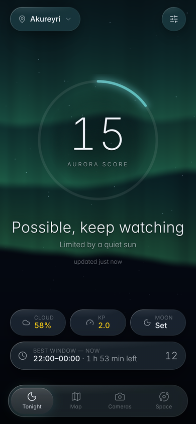
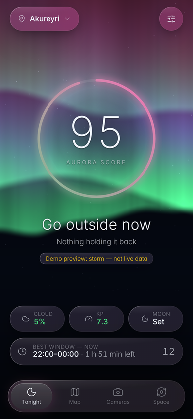
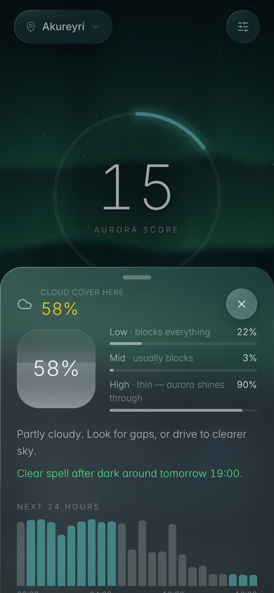
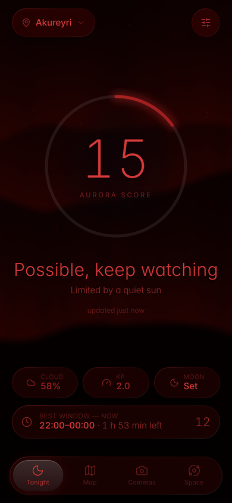

# Norðurljós: Iceland Aurora Hunter

> **Should I go out and look right now, and where?**

A mobile-first PWA for aurora hunting in Iceland. It combines darkness, moon, cloud cover and space weather into one
clear answer, built to be used outdoors at night, in the cold, with gloves on and patchy signal.

<p>
  
  
  
  
</p>

**Status:** Phase 1 (Foundation) ✅ · Phase 2 data (Aurora Score, OVATION) ✅ · Design overhaul step 1 (design system, liquid glass,
tab bar, Tonight hero, live aurora sky) ✅ — awaiting design review. See [CHANGELOG.md](CHANGELOG.md) and the [roadmap](#roadmap).

**Design preview:** append `?demo=quiet`, `?demo=active` or `?demo=storm` to the URL to preview how the sky, ring and verdict look
on stronger nights. It is clearly badged "not live data".

## Quick start

Requires Node 20+.

```bash
npm install
npm run dev          # API on :8787, web on :5173 (Vite proxies /api → :8787)
```

Open http://localhost:5173. To try it on your phone on the same Wi-Fi, use `http://<your-computer-ip>:5173`. GPS needs
HTTPS on most phones, but you can still pick a base from the list.

```bash
npm test             # vitest: core + server
npm run typecheck
npm run build        # builds web (PWA) + server bundle
npm start            # production: one Node process serves the API and the PWA on :8787
```

### Environment variables

Copy `.env.example`. None are required for local dev.

| Var | Where | Purpose |
| --- | --- | --- |
| `CONTACT_EMAIL` | server | Added to the User-Agent. MET Norway's terms require contact info. **Use a real address**: placeholder domains like `example.com` get HTTP 403. |
| `PORT` | server | Default `8787`. |
| `CORS_ORIGIN` | server | Default `*` (data is public and read-only). Set it if you host the web app on another origin. |
| `WEB_DIST` | server | Path to the built PWA (default `apps/web/dist`). |
| `VITE_API_BASE` | web build | Only if the API is on a different origin. |

### API keys

**Phase 1 needs none.** NOAA SWPC, Open-Meteo and MET Norway are keyless. Coming up:

- **Map tiles (Phase 3):** OpenFreeMap needs no key; MapTiler or Stadia need a free key if you prefer their styles.
- **Push (Phase 6):** VAPID keys, which you generate yourself (`npx web-push generate-vapid-keys`). No account needed.
- Vegagerðin (road.is) / Icelandic Met Office will be evaluated in Phases 4–5. Their terms decide embed vs. link-out.

## Deploy

**Single Node service** (Fly.io, Render, Railway, a VPS):

```bash
npm ci && npm run build
CONTACT_EMAIL=you@yourdomain.is PORT=8080 npm start
```

The server serves the PWA with correct cache headers: hashed assets are immutable, while `sw.js` and HTML use `no-cache`.
Put it behind HTTPS, because PWA install, GPS and push all require HTTPS.

**Cloudflare Workers:** `apps/server/src/app.ts` is runtime-agnostic Hono (`createApp({ fetcher })`). A Worker entry just
needs to export `createApp(...)`, with the web `dist/` served by Pages. The in-memory cache works per isolate; swap it for
the Cache API or KV for cross-isolate caching. This will be wired up when we pick the host.

## Design system

All visual decisions live in `apps/web/src/design/`:

| File | What |
| --- | --- |
| `tokens.css` | Colour (midnight base, aurora accents), glass recipe, radius, spacing, shadow, motion durations, type, z-layers. Mode switches on `<html>`: `data-mode="night"`, `data-transparency="reduced"`, `data-power="low"`, `data-refract`. |
| `tokens.ts` | Springs (`stiffness 300, damping 30`), press scale, stagger, score colour ramp (grey → teal → green → magenta). |
| `theme.css` | Tailwind aliases (`text-ink-2`, `bg-glass`, `rounded-xl`, …) → tokens. |
| `glass.css` | Liquid glass: blur 32px + saturate 170%, 8% tint + live aurora tint, 1px gradient edge highlight, tilt-driven specular sheen, Chromium-only SVG refraction, glass skeleton shimmer, text scrim. |

Components (`src/ui/`): `Glass`, `Press` (0.96 press, glow ripple, haptic), `TabBar` (morphing liquid pill), `Sheet` (peek/half/full, spring +
rubber-band, drag handle), `ScoreRing`, `StatPill`/`StatHeader` (shared-element morph), `Sparkline`, `Toggle`, `Segmented`.
The sky (`src/sky/`) is a WebGL1 shader driven by live Kp / Bz / solar-wind speed (`skyParams.ts`), with a CSS fallback.

Accessibility & comfort: Reduce motion (system/on/off → `MotionConfig`), Reduce transparency (system/on/off, honours
`prefers-reduced-transparency`), Low power (30 fps half-res sky, lighter glass, no sheen/refraction), Night Vision (all-red tokens,
dimmed sky, set before first paint), 48px+ targets, screen-reader labels on every control and chart.

## Architecture

```
packages/core     Pure TS, no I/O. Unit-tested.
  astro.ts          sun/moon/twilight, 24 h night plan (sampling-based → works in polar night & midnight sun)
  parse/noaa.ts     Kp, Kp forecast, RTSW solar wind + IMF (active-spacecraft selection), G-scale
  parse/clouds.ts   Open-Meteo, MET Norway, effective cloud, two-source consensus + confidence
  geo.ts            distance, coordinate snapping, Iceland quick-pick places

apps/server       Hono API proxy
  lib/sources.ts    registry of every upstream: TTL, stale window, timeout, attribution
  lib/fetcher.ts    cache + stale-on-error + coalescing + retry/backoff + circuit breaker + health
  app.ts            routes (portable: Node or Workers)
  index.ts          Node entry + static PWA hosting

apps/web          React 19 + Vite + Tailwind 4 + React Query + Zustand + vite-plugin-pwa
```

### API

| Endpoint | Cache | Notes |
| --- | --- | --- |
| `GET /api/space-weather` | Kp 5 min, forecast 15 min, solar wind 1 min | Kp now / next-24 h peak / series, G-scale, latest speed/density/Bt/Bz, 15-min Bz average, 6 h series (5-min buckets), spacecraft. |
| `GET /api/clouds?lat=&lon=` | 10–15 min | Coordinates are snapped to 0.05° (~5 km) **before** going upstream. Returns consensus layers, effective %, confidence, 48 h hourly, temperature and wind. |
| `GET /api/aurora?lat=&lon=` | 5 min | NOAA OVATION at the snapped location: `overhead` and distance-weighted `visible` (aurora up to ~800 km away, low on the horizon). |
| `GET /api/score?lat=&lon=` | per source | Composite Aurora Score (same pure function as the app), verdict, limiting factor, factors, missing inputs, 18 h outlook and best 2 h window. For widgets, share cards and alerts. |
| `GET /api/health` | none | Per-source breaker state, last success/error, latency, request and hit counts. UI: `#/health`. |

Every response carries `meta.sources[]` with `ok`, `stale` and `fetchedAt`, so the UI can always show data age and credits.
If one source fails, the endpoint returns partial data instead of an error. Clouds returns 503 only when *both* sources are down.

### Resilience

- **Stale-on-error:** after the TTL expires, the last good value is kept for hours and served (flagged `stale`) if upstream fails.
- **Circuit breaker:** 4 consecutive failures stop calls to that source for 2 minutes, then one trial request is allowed.
- **Retries:** network errors, 5xx and 429 are retried with exponential backoff. Other 4xx responses fail fast.
- **Client:** last successful responses are saved in localStorage and the service worker uses NetworkFirst with a 6 s
  timeout, so the screen is never blank on a mountain pass. Sun and moon are computed on the device and work fully offline.

## Data sources (verified 2026-11-02)

| Source | Endpoint | Status |
| --- | --- | --- |
| NOAA SWPC Kp | `services.swpc.noaa.gov/products/noaa-planetary-k-index.json` | ✅ Format changed to array of objects (legacy format still parsed) |
| NOAA SWPC Kp forecast | `…/products/noaa-planetary-k-index-forecast.json` | ✅ observed / estimated / predicted |
| NOAA RTSW plasma | `…/json/rtsw/rtsw_wind_1m.json` | ✅ ACE + IMAP + SOLAR1 mixed; we use the `active` one |
| NOAA RTSW IMF | `…/json/rtsw/rtsw_mag_1m.json` | ✅ Bz in GSM |
| ~~NOAA products/solar-wind/*~~ | `…/products/solar-wind/plasma-2-hour.json` etc. | ❌ **404, removed.** Do not use. |
| NOAA OVATION | `…/json/ovation_aurora_latest.json` | ✅ ~900 KB, 1° grid; parsed once per 5 min server-side |
| IMO (vedur.is) | `api.vedur.is` (OpenAPI: weather, CAP warnings, …) | ✅ Public API. **No aurora-forecast endpoint** (web page only → we link out). Ceilometer cloud obs (`/weather/observations/aws/raw/cloud/1min/latest`) and CAP warnings planned for "Is it clear?" and the safety layer |
| Open-Meteo | `api.open-meteo.com/v1/forecast` | ✅ low/mid/high cloud. Occasional 429 from shared IPs, so the cache matters |
| MET Norway | `api.met.no/weatherapi/locationforecast/2.0/complete` | ✅ low/mid/high in `/complete` only. Needs an identifying User-Agent |
| Sun & moon | SunCalc, on device | ✅ |

Attribution is shown in the app footer. Open-Meteo and MET Norway data are CC BY 4.0.

## Roadmap

1. ✅ **Foundation:** scaffold, theming, location, astronomy, API proxy
2. ✅ **Data:** OVATION at your location, Aurora Score (0–100, pure + documented weights + tests), verdict + limiting factor, best window
   - ✅ **Design overhaul step 1:** design system, liquid glass, tab bar, Tonight hero + live aurora sky, sheets, Settings, Space re-skin
   - ⏳ Step 2: re-skin Map + Cameras as they're built · Step 3: motion polish (celebration, pull-to-refresh ribbon), onboarding, share card · Step 4: perf + a11y pass on real iOS/Android
3. **Map:** MapLibre, terminator, OVATION + cloud layers, 48 h time slider
4. **Cameras:** config-driven camera wall, status, attribution
5. **Best-spot finder, night planner, roads and safety**
6. **Alerts and full offline:** web push, thresholds, quiet hours
7. **Photographer mode, AR compass, sighting log**
8. **Polish:** i18n (IS/DE/FR/ZH/JA), a11y audit, onboarding, store assets
