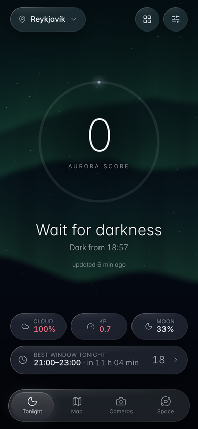
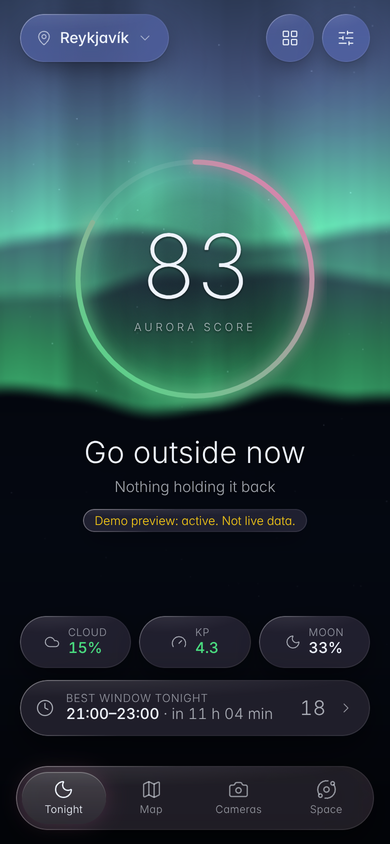
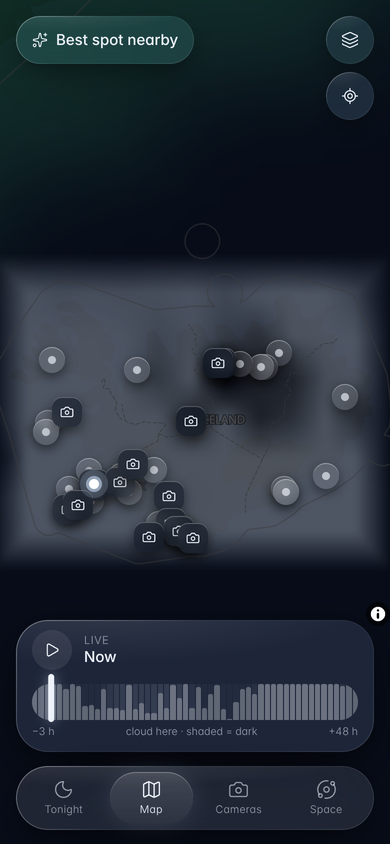
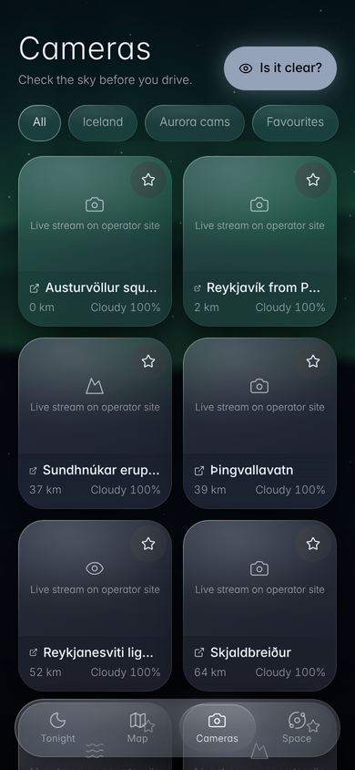
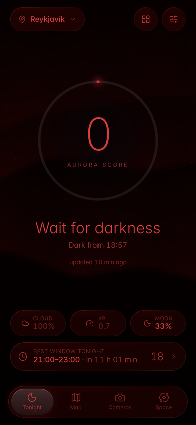

# Norðurljós: Iceland Aurora Hunter

> **Should I go out and look right now, and where?**

A mobile-first PWA for aurora hunting in Iceland. It combines darkness, moon, cloud cover and space weather into one
calm answer, then shows you where the sky is clear, which cameras to check, how to drive there safely, and how to
photograph it. It's built for use outdoors at night, in the cold, with gloves on and patchy signal.

<p>
  
  
  
  
  
</p>

**Status: v1.1, all 8 phases, design steps 1–4 and addendum Tiers 1–6 complete.** See [CHANGELOG.md](CHANGELOG.md) and
[docs/screens](docs/screens) for every screen.

## What's in it

| Tab / tool | What it does |
| --- | --- |
| **Tonight** | Giant score ring (0–100) with a one-line verdict, the limiting factor, and Cloud / Kp / Moon pills that expand into detail sheets. Also the best-window countdown, a weather-warning chip and pull-to-refresh. The "Go now" moment gets a pulse, a shimmer and an optional chime. |
| **Map** | MapLibre over a muted dark base: OVATION aurora oval as a glow, cloud cover as mist that cross-fades by hour, the darkness terminator, VIIRS light pollution, dark-sky spots (pulse when clear and dark), webcams, community sightings. Time scrubber covers −3 h → +48 h with hourly snap, haptic ticks and play. |
| **Best spot nearby** | Ranks curated spots by cloud, darkness, activity and light pollution within 60–500 km. Shows drive time, a **Start driving** link (Apple/Google Maps), "tell someone your plan", and return-time and road warnings. |
| **Cameras** | Two-column glass wall: live status, distance, cloud tag, favourites, filters, a fullscreen viewer (swipe down to close) and a **timelapse** of the last few hours. Plus **Is it clear right now?**: IMO ceilometer observation, the forecast model and the closest camera. |
| **Space** | Substorm nowcast with a live ground magnetometer (Narsarsuaq/Abisko), Kp bars (24 h + 3 days), Bz, solar wind speed and density sparklines, each with plain-English captions. |
| **Tools** | I see aurora! (community log), Tonight's plan, Safety & roads, Photographer mode, AR sky compass, Journal & badges, Share tonight (story card), Ambient mode, Learn (offline cheat sheet). |
| **Alerts** | Web push for score ≥ threshold, Kp forecast, Bz flips south, substorm likely or onset, and a cloud gap opening. Has quiet hours and per-rule cooldowns, and the server polls every 5 minutes. |
| **Offline** | The app shell and the map chunk are precached. API responses are network-first with the last good copy kept. "Save Iceland map" downloads about 300 vector tiles, glyphs and sprites. Sun and moon are computed on the device. |
| **Reliability** | Data health sheet (live / stale / down per source, with age vs expected refresh), stale and offline badges on every number, "Prepare for tonight" (one tap caches forecast, map tiles around you, spots and tips), an offline outbox for reports, and a morning "Did you see it?" prompt that feeds score validation. |
| **Safety** | Road-condition and weather-warning map layers, a route corridor (warnings, gusts ≥ 15 m/s and gravel along the way), shareable trip plans (`#/plan/<id>`) with check-in and an overdue push to your contact, and context tips. |
| **Smarter forecasting** | Cloud-gap hunter (where it clears within your drive limit, when to leave, when to head back), a 5-night outlook (NOAA 3-day + 27-day outlook × 6-day cloud), and personal limits: max drive, darkness threshold, camera or naked eye, favourite spots. |
| **Field tools** | Tonight's checklist, battery saver (refresh ×3 slower, sky off), driving mode with large type and optional spoken alerts, and a photo shot log that suggests settings from your past shots. |
| **Community** | Sightings verified when two or more people nearby agree, an optional photo, private sightings, report/hide moderation, a live layer on the map and a weekly feed. |
| **Privacy & product** | Approximate location by default (precise only on request), export or delete your data, opt-in analytics and crash reports, Sources & credits, and server-side feature flags. |
| **Comfort** | Night Vision (all red), Reduce motion / transparency (system, on or off), Low power (30 fps sky), haptics, units, and 6 languages (EN, IS, DE, FR, 中文, 日本語). |

**Design preview:** add `?demo=quiet|active|storm` to the URL to see stronger nights. It's clearly labelled "not live data".

## Quick start

Requires Node 20+.

```bash
npm install
npm run dev          # API on :8787, web on :5173 (Vite proxies /api → :8787)
npm test             # 168 tests: core logic, parsers (recorded fixtures), server routes, web helpers
npm run backtest     # score validation against real OMNI2 storm/quiet nights → DATA_DIR/backtest/report.md
npm run typecheck
npm run build        # PWA + server bundle
npm start            # production: one Node process serves the API and the PWA on :8787
```

On your phone (same Wi-Fi), open `http://<computer-ip>:5173`. GPS, install and push need HTTPS, so deploy behind TLS
for field use.

### Environment variables

See `.env.example`. **None are required.**

| Var | Purpose |
| --- | --- |
| `CONTACT_EMAIL` | Added to the User-Agent (MET Norway terms). Use a real address; placeholder domains get 403. |
| `VAPID_PUBLIC_KEY` / `VAPID_PRIVATE_KEY` / `VAPID_SUBJECT` | Web-push keys. If unset, a pair is generated once into `DATA_DIR/vapid.json`. Set them in production so subscriptions survive redeploys. |
| `CONFIG_DIR` / `DATA_DIR` | `config/` (spots, cameras) and `data/` (subscriptions, sightings, keys). Mount `DATA_DIR` on a persistent volume. |
| `ADMIN_TOKEN` | Turns on `/admin?token=…` (score validation, sighting moderation, telemetry totals). Off when unset. |
| `OPEN_METEO_API_KEY` | Uses Open-Meteo's paid `customer-api` host. **Required for commercial use**; the free tier is non-commercial. |
| `PORT`, `CORS_ORIGIN`, `WEB_DIST`, `ALERT_INTERVAL_MS`, `VITE_API_BASE` | As named. |

### API keys

**No accounts are needed** for personal / non-commercial use. Every source is keyless (NOAA, Open-Meteo, MET Norway,
IMO, Vegagerðin, INTERMAGNET, OpenFreeMap, NASA GIBS). VAPID keys are self-generated. A commercial launch needs an
Open-Meteo key and INTERMAGNET permission (see Data sources).

### Editing spots and cameras

`config/spots.json`, `config/cameras.json`, `config/score-weights.json` (score tuning, versioned) and
`config/features.json` (feature flags, e.g. `alerts.advanced`) are re-read when they change, so no restart is needed. Cameras are either
`embed: "image"` (a public still image we proxy, with attribution) or `embed: "link"` (opens the operator's own page).
Only use `image` where the operator's terms allow it.

## Deploy

Run it as a **single Node service** (Fly.io, Render, Railway, a VPS):

```bash
npm ci && npm run build
CONTACT_EMAIL=you@yourdomain.is DATA_DIR=/data PORT=8080 npm start
```

The server serves the PWA (immutable hashed assets, `no-cache` for the service worker and HTML), runs the alert poller and
captures camera frames for timelapses. It's a single instance, because cache, timelapse frames and the JSON store are local.

**Cloudflare Workers:** `apps/server/src/app.ts` is runtime-agnostic Hono. A Worker needs KV/D1 in place of the JSON store,
the Cache API in place of the in-memory cache, and a Cron Trigger calling `services.runAlerts()`.

**Native wrappers (later):** Capacitor gives iOS haptics, real home-screen and lock-screen widgets, and background
location. The `#/widget` route is the web stand-in.

## Architecture

```
config/           spots.json, cameras.json   (edit without code changes)
packages/core     Pure TS, no I/O, unit-tested
  astro.ts          sun/moon/twilight, 24 h night plan (sampling → polar night & midnight sun safe)
  score.ts          Aurora Score = 100 × activity × sky × dark × moon (documented WEIGHTS), outlook, best window
  grid.ts           cloud grid + bilinear sampling, night-side polygon (terminator)
  spots.ts          spot ranking, drive time, light-pollution factor, maps deep links
  geometry.ts       aurora elevation (Earth curvature), bearing, arc prediction for the AR compass
  substorm.ts       INTERMAGNET parser, ground "negative bay", substorm nowcast
  alerts.ts         alert rules, quiet hours, cooldowns (shared by server poller and app)
  photography.ts    NPF/500 rules, exposure suggestions, naked-eye vs camera expectations
  parse/*           NOAA (Kp, RTSW, OVATION), Open-Meteo, MET Norway, IMO (CAP, ceilometers), Vegagerðin

apps/server       Hono API proxy + background jobs
  lib/fetcher.ts    TTL cache, stale-on-error, coalescing, retry/backoff, circuit breaker, health, binary images
  lib/sources.ts    every upstream: TTL, stale window, timeout, attribution
  routes/extras.ts  map grids, cameras, safety, clear-now, nowcast, sightings, push
  index.ts          Node entry, VAPID, web-push sender, 5-min poller, static PWA

apps/web          React 19 · Vite · Tailwind 4 · Motion · MapLibre · React Query · Zustand · Workbox
  design/           tokens.css / tokens.ts / glass.css: the design system
  ui/               Glass, Press, TabBar, Sheet, ScoreRing, StatPill, Sparkline, Controls, Onboarding, PullToRefresh
  sky/              WebGL aurora shader driven by Kp / Bz / wind speed
  screens/, sheets/ one idea per screen; detail lives in draggable sheets
  sw.ts             service worker: precache, API fallback, tile cache, push
```

### API

| Endpoint | Purpose |
| --- | --- |
| `GET /api/space-weather` | Kp now, peak and series; solar wind; Bz/Bt (15-min average, 6 h series) |
| `GET /api/clouds?lat&lon` | Open-Meteo + MET Norway consensus, layers, confidence, 48 h hourly, wind and temperature |
| `GET /api/aurora?lat&lon` | OVATION overhead and "within view" (~800 km) |
| `GET /api/score?lat&lon` | Composite score, verdict, limiting factor, outlook, best window |
| `GET /api/nowcast` | Substorm nowcast, ground magnetometer series, 1-min Kp estimate |
| `GET /api/grid/clouds` · `/api/grid/ovation` | Map layers (Iceland 117-point cloud grid, OVATION 45–85°N) |
| `GET /api/spots` · `/api/cameras` · `/api/cameras/:id/image` · `/api/cameras/:id/frames[/:i]` | Config data, camera proxy, timelapse |
| `GET /api/safety?lat&lon` | IMO warnings (incl. "applies here"), nearby road conditions, wind and road temperature |
| `GET /api/clear-now?lat&lon` | Nearest IMO ceilometer observation, model cloud, nearest camera |
| `GET/POST /api/sightings` | Anonymous reports, snapped to ~10 km, expire after 12 h, rate-limited |
| `GET /api/push/key` · `POST /api/push/subscribe` · `/unsubscribe` · `/test` | Web push |
| `GET /api/health` | Per-source state (ok / stale / down / idle), age vs expected refresh, breaker, last error |
| `GET /api/roads` · `/api/warnings` · `/api/route?from&to` | Road layer, warning polygons, route corridor hazards |
| `POST /api/plans` · `GET /api/plans/:id` · `/location` · `/checkin` | Shared trip plans with overdue push |
| `GET /api/outlook?lat&lon` | 5-night outlook |
| `GET /api/feed` · `/api/sightings/:id/photo\|report\|delete` | Weekly feed, photos, moderation (owner token) |
| `POST /api/outcomes` · `/api/telemetry` · `/api/crash` | Did-you-see-it feedback, opt-in analytics and crash reports |
| `GET /api/sources` · `/api/features` · `/api/score-weights` | Credits and terms, feature flags, score weights |
| `GET /admin?token=` | Internal dashboard (validation, moderation, telemetry) |

User locations are snapped to ~5 km before anything goes upstream. Sightings are stored at ~10 km (private ones at
~25 km and never shown to others). Owner tokens are stored as SHA-256 hashes; there are no accounts. Analytics and crash
reports are off until you opt in, and contain no location. The journal and shot log stay on the device. Settings →
Privacy & data exports or deletes everything.

## Design system

`apps/web/src/design/` is the single source of truth: colour (midnight base; emerald, teal, violet and magenta used
sparingly), glass (blur 32 px, saturate 170 %, 8 % tint plus a live aurora tint, gradient edge highlight, tilt-driven
sheen, Chromium-only SVG refraction), radius, spacing, shadow and springs (stiffness 300, damping 30). Modes are
attributes on `<html>`: `data-mode="night"`, `data-transparency="reduced"`, `data-power="low"`. Base styles sit in
`@layer base` and glass in `@layer components`, so utilities always win.

**Accessibility:** zero axe-core violations (WCAG 2.1 AA + best practice) on Tonight, Map, Cameras, Space, Settings,
Tools and detail sheets. Targets are 48 px or larger, text on the sky has a scrim, every chart has a text label,
sheets are keyboard-closable with focus management, and the scrubber is a real slider with arrow keys.

**Performance:** the first load is about 180 KB of JS (gzip). MapLibre (300 KB) and rarely used tools are split into chunks
and prefetched when the browser is idle. The sky is capped at 60 fps (30 in Low power) and pauses when hidden.
Animations are transform/opacity only.

## Data sources (verified 2026-11-03)

| Source | Use | Notes |
| --- | --- | --- |
| NOAA SWPC | Kp, Kp forecast, 1-min Kp estimate, RTSW solar wind and IMF, OVATION | `products/solar-wind/*` has been **removed (404)**; we use `json/rtsw/*` (active spacecraft, currently SOLAR1) |
| Open-Meteo | Cloud (low/mid/high), wind, temperature; 117-point Iceland grid; 6-day; archive | CC BY 4.0. **Free tier is non-commercial**: set `OPEN_METEO_API_KEY` for commercial use |
| MET Norway | Second cloud source (`/complete` has layers) | CC BY 4.0, identifying User-Agent |
| Icelandic Met Office `api.vedur.is` | CAP warnings; ceilometer cloud observations | No aurora-forecast endpoint, so we link to vedur.is |
| Vegagerðin `gagnaveita.vegagerdin.is` | Road weather stations; road conditions | Road cameras have no public image API, so we link to umferdin.is |
| INTERMAGNET (GIN) | Ground magnetometer: Narsarsuaq (DTU), Abisko (SGU) | Leirvogur (Iceland) isn't in the real-time service. **Commercial use needs permission** from the institutes |
| OpenFreeMap | Dark vector base map | © OpenMapTiles, © OpenStreetMap contributors |
| NASA GIBS | VIIRS Black Marble light pollution | |
| NOAA SWPC 27-day outlook | 5-night outlook | Text product, parsed |
| NASA OMNI2 (SPDF) | Backtest of the score on historical storm/quiet nights | Public domain |
| UiT, SGO/Oulu, AuroraMAX (CSA/UCalgary) | **Link-out only** (changed in v1.1) | Sodankylä prohibits public presentation without permission; all three are links until the operators agree |
| Live from Iceland (Míla), IRF Kiruna, Lights over Lapland, UAF, FMI | Link-out cameras | |

## Known limitations

- Tested in headless Chromium with Android Chrome emulation (slow 3G + 4× CPU: score in 6.0 s cold, ~1.1 s warm) and at
  iPhone size, but not yet on physical iOS Safari. Headless WebGL is
  software-rendered, so its frame rates aren't representative.
- Web-push on iPhone requires adding the app to the Home Screen (iOS 16.4+). iOS doesn't support `navigator.vibrate`, so haptics come with the Capacitor wrapper.
- Sighting photos are moderated after the fact (report → auto-hide at 3 reports, admin review). There's no automatic
  image screening, so someone has to own moderation before a public launch.
- The route corridor uses a straight line between you and the spot, not real road geometry (no routing provider yet).
- The 5-night outlook beyond 3 days rests on NOAA's 27-day Kp outlook, which is coarse; those nights are marked "Kp from NOAA 27-day outlook (rough)".
- Camera "clear/cloudy" tags are forecasts at the camera, not image analysis.
- Translations cover all main screens. Long-form explanations (Learn, detail copy) are English for now.
- `npm audit`: moderate/low advisories remain in build-time Workbox tooling only (nothing that ships).
